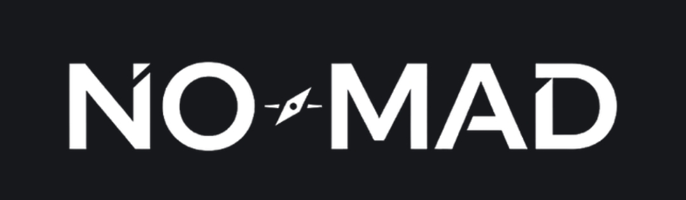
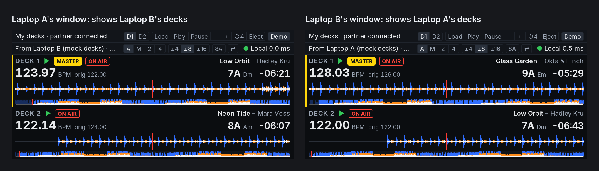
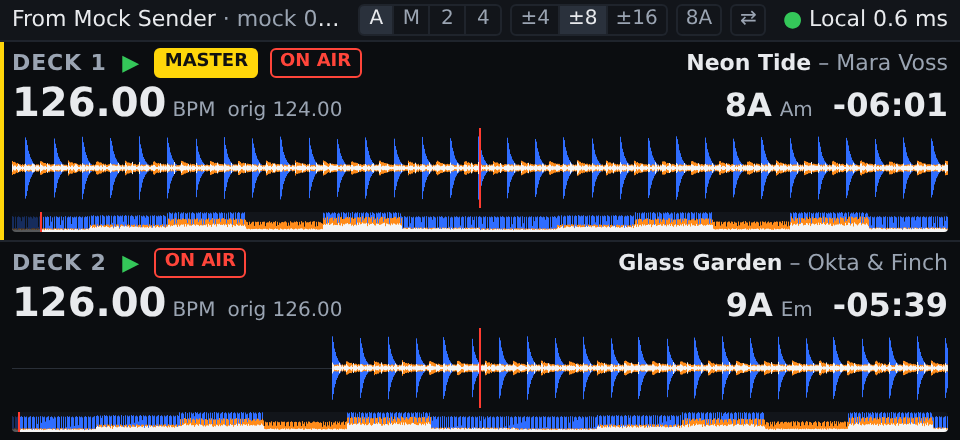

<p align="center"></p>

# Face2Face DJ

**See your back-to-back partner's decks on your own screen, and they see yours.**

When two DJs play back-to-back (B2B) from two laptops in the same booth, each one
can only see their own software. Face2Face DJ links the two laptops over the local
network. Each laptop does two things at once:

- as a **Sender** it reads the state of its own DJ software's decks and streams it;
- as a **Viewer** it shows the partner's decks in a small always-on-top window:
  scrolling waveform, current and original BPM, musical key (Camelot and standard
  notation), remaining time, play/pause, master and on-air status, for up to four decks.

So each DJ can see what the other is playing, where the phrase ends and what key
and tempo to mix into, without leaning over the other laptop. Choose **Link up**
on both laptops for this two-way mode; **Share only** and **View only** are the
two halves on their own.



How it works, briefly:

- **One WebSocket per direction.** A linked pair is two independent one-way links,
  one from each laptop's Sender to the other's Viewer. JSON messages for track loads
  and deck state (60 Hz per deck), binary frames for waveform data, a 1 Hz heartbeat.
  Spec: [`docs/PROTOCOL.md`](docs/PROTOCOL.md).
- **Clock sync + interpolation.** The Viewer estimates the Sender's clock from
  ping/pong round trips and extrapolates each deck's position between updates, so
  the waveform scrolls smoothly and stays in time with the real deck.
- **Read-only by design.** It never writes to a DJ library or to music files.
- **Sources:** mock decks with synthetic waveforms, and readers for Traktor,
  rekordbox (via rkbx_link), Pro DJ Link players (CDJ, XDJ) and Mixxx. The readers
  are new and not yet tried against the real programs: [`docs/SOURCES.md`](docs/SOURCES.md).

Built with Tauri 2: a Rust core (protocol, deck sources, waveforms, networking)
and a TypeScript + React UI drawing on Canvas 2D. Design decisions are logged in
[`docs/DECISIONS.md`](docs/DECISIONS.md). The project's working name was *Tandem*.

## Status: Milestone 0 (foundations), plus deck readers and two-laptop linking

Two laptops can link over a network with an address and a pairing code
([`docs/SETUP.md`](docs/SETUP.md)); finding the partner automatically is not
built. Real decks can be read (below), but show no waveform until audio
analysis exists. No audio files are read yet.

| Part | State |
|---|---|
| Viewer UI, clock sync, interpolation, reconnect (TypeScript) | Built and tested |
| Mock sender tool (TypeScript) | Built and tested |
| Rust core (`crates/face2face-core`) | Built and tested (`cargo test`) |
| Desktop app (`app/src-tauri`), including two linked windows | Built and run on Linux; builds on macOS. Not yet tried on Windows |
| Linking two laptops: address + pairing code (`net/pairing.rs`, `app/src/pairing.ts`) | Built and tested; run on one Mac over its network address. Not yet between two laptops |
| Readers: Traktor, rekordbox, Pro DJ Link, Mixxx (`crates/face2face-core/src/sources`) | Built and tested with hand-built messages. Not yet run against the real programs or players |



(480x220 window at 2x, driven by `npm run mock-sender`. More in `docs/screenshots/`.)

## What you need

- Node.js 22.18 or newer, with npm.
- For the desktop app: Rust (stable, 1.77.2 or newer) and the Tauri 2
  prerequisites for your OS: https://tauri.app/start/prerequisites/
  On Linux also the ALSA development package (`libasound2-dev`), for MIDI.

## Run it

```sh
npm install
```

**In a browser (no Rust needed).** Two terminals:

```sh
npm run mock-sender     # stand-in Sender with a scripted demo on ws://127.0.0.1:47801
npm run dev             # then open http://localhost:1420 and choose "View only"
```

The mock sender takes commands on its terminal while it runs: `help` lists them
(`load 1`, `play 1`, `pause 1`, `pitch 1 2.5`, `jump 1 -16`, `eject 1`, ...).
`npm run mock-sender -- --no-demo` starts it without the script, `--decks 4` with four decks.
A browser can only view; sharing decks needs the desktop app.

**As the desktop app.**

```sh
cargo test              # Rust core tests
npm run tauri dev       # opens the Face2Face DJ window
```

**Two laptops.** Put both on one network, choose **Link up** on both, and type
each other's address and pairing code, which each window shows. The full guide,
including how to create the network, is [`docs/SETUP.md`](docs/SETUP.md).

**Two-way on one computer.** Choose **Link up** in the window, then **My partner
is on this computer**. Start a second copy of the app and do the same there.
While `tauri dev` runs, the second copy is the program it built:

```sh
./target/debug/face2face-dj          # Windows: target\debug\face2face-dj.exe
```

Each window starts its own Sender with mock decks and shows the other window's
decks. The first to link is "Laptop A" (port 47801), the second "Laptop B" (port
47802); they load different mock tracks so you can tell them apart. The top row
of buttons controls your own mock decks, which the *other* window displays.

**Your real decks.** The menu at the left of the Sender window's control row
chooses where your decks come from: mock decks, Traktor, rekordbox, Pro DJ Link
or Mixxx. Each needs something set up on the DJ software's side first; see
[`docs/SOURCES.md`](docs/SOURCES.md). To try a reader without the window:

```sh
cargo run --example sender -- traktor     # then `npm run dev`, open http://localhost:1420, "View only"
```

**One-way.** **Share only** starts the Sender and previews what a partner would
see; its top bar shows the address and pairing code a viewer needs. For a viewer
on the same computer, open http://localhost:1420 in a browser while `tauri dev`
runs, choose **View only**, press **Partner**, and enter `127.0.0.1` and that code.

## Check it

```sh
npm test                # TypeScript unit + integration tests (Node's test runner)
npm run typecheck
npm run build           # production build of the UI
cargo test              # Rust unit + integration tests
```

## Layout

```
docs/                 PROJECT_BRIEF, DECISIONS, PROTOCOL, SETUP, SOURCES, screenshots, brand (logo)
app/                  the desktop app
  src/                UI (TypeScript, React)
    protocol/         wire messages and binary waveform chunks
    net/              clock sync, interpolation, WebSocket connection
    state/            Viewer state and waveform cache
    waveform/         canvas drawing
    views/            RoleSelect, Viewer, Sender, PartnerSetup
    components/       DeckCard, WaveformView, StatusBar, KeyBadge
  src-tauri/          Tauri shell: commands that call face2face-core
crates/face2face-core/  Rust core: protocol, sources (mock, traktor, rekordbox, prolink,
                        mixxx), waveform (synthetic), session, net (transport), sender
  examples/sender.rs    a Sender without a window, for trying a reader
tools/mock-sender/    stand-in Sender for developing the Viewer
tools/mixxx-mapping/  the controller mapping to install in Mixxx
test-assets/          fixtures shared by the TypeScript and Rust tests
```

## Safety rules that already apply

Face2Face DJ never writes to a DJ library or to music files (brief, section 12).
It reads and writes nothing outside this folder and the browser's or webview's
own local storage: three display settings, a device id, this laptop's pairing
code, and the partner's address and code.

On the network: the Sender accepts connections from other computers only with
this laptop's pairing code ([`docs/SETUP.md`](docs/SETUP.md) says what the code
does and does not protect). The deck readers only receive: Traktor's,
rekordbox's and Mixxx's listen on this computer for what a helper sends them.
The Pro DJ Link reader is the one that transmits: it announces itself on the
players' network and asks players for track names, as any player on that
network does.
